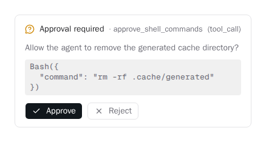

# Agent session patterns: a design study

**An interaction language for supervising coding agents you aren't watching.**

This is an unofficial design study built against [Omnigent](https://github.com/omnigent-ai/omnigent), the open-source meta-harness from Databricks. It's an independent study, not affiliated with or endorsed by Databricks.

When you run four or five coding agents at once, most of your time isn't spent watching them work. It goes to the moments in between:

- an agent pauses for approval while you're on your phone
- a policy blocks a push
- a runner goes quiet and the spinner keeps spinning

Those moments decide whether people trust a fleet of agents or babysit it. This repo is my take on designing them.

<table>
<tr><th>Omnigent today</th><th>Proposed</th></tr>
<tr>
<td width="55%" valign="top">  The header shows the policy's internal ID and phase. The message says "the agent," and nothing says what happens if you don't answer.</td>
<td width="45%"></td>
</tr>
</table>

## What's here

| | |
|---|---|
| **[Audit](docs/audit.md)** | A close read of how Omnigent handles approvals, status, policy blocks, and errors today. It covers what works well and five specific gaps, with screenshots of Omnigent's current interface and file references, each paired with the proposed fix. |
| **[Pattern spec](docs/agent-states.md)** | It includes: <ul><li>eight harness-neutral session states</li><li>a seven-part anatomy for any approval request</li><li>a scope ladder for "how far does my yes reach"</li><li>a three-layer structure for policy messages</li><li>a state icon set and a state diagram</li></ul> |
| **[Prototype](prototype/)** | A working mobile prototype covering triaging sessions, approving a sub-agent's `git push`, a policy block, and lost contact. It's a single HTML file. [View it live](https://jkelleman.github.io/omnigent-agent-session-patterns/design-study/prototype/) or open it locally. |
| **[Evals](evals/)** | A rubric plus an LLM-as-judge harness that scores agent status and approval messages for whether a person can act on them. It runs against Omnigent's real strings and my rewrites, with a rule-based baseline for comparison. |

## The short version

1. **Say who is asking, and who made the rule.** "Blocked by policy" isn't actionable. "Set by your workspace admin" is.
2. **Show how far a yes reaches before the tap.** Use one scope ladder (*once · this session · always for this agent*) on every surface.
3. **Not answering is a decision.** Every pending request shows its deadline and its default.
4. **Never show activity you can't verify.** "Working" comes with "last heard 12s ago". Past a threshold, it's *Lost contact*.
5. **One event, one voice.** "Codex needs input" and "Claude has questions" are the same event, so they should read the same.

## Why the evals

Interface copy for agents is generated, templated, and multiplied across a dozen harnesses. You can't review every string by hand, so the quality bar has to be something a machine can check. The rubric in [`evals/rubric.md`](evals/rubric.md) turns "is this message clear?" into five checks a reviewer, human or model, can score consistently:

- **Actor:** who is acting
- **Action:** what it's doing
- **Cause:** why it paused, and who owns the rule
- **Consequence:** what each answer, or no answer, does
- **Next move:** what this reader can do

## How this was made

I built this with coding agents. Source reading, scaffolding, and the prototype were done in Claude Code, and the commit history reflects that.

---

*Jen Kelleman · content and product designer for AI agents · [jkelleman.com](https://jkelleman.com)*
