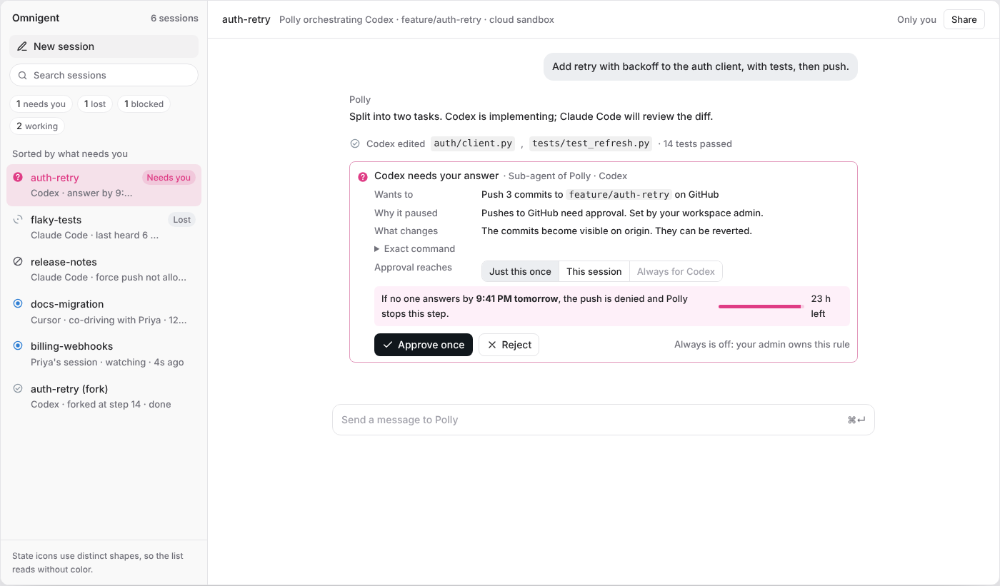

# Agent session patterns: a design study

**Interaction and content patterns for supervising coding agents asynchronously.**

An independent design study of [Omnigent](https://github.com/omnigent-ai/omnigent), the open-source meta-harness from Databricks. Databricks has not reviewed or endorsed it.

> **Summary:** Five findings in how Omnigent handles human-in-the-loop approvals, policy blocks, and session status. Approval scope goes from 10+ labels to 3. None of the 58 readable built-in policy messages name the rule's owner; the proposed three-layer pattern fixes that for all of them. Rewritten messages score 8.6 out of 10 against Omnigent's 2.0 on a reproducible baseline. Live [mobile](https://jkelleman.github.io/omnigent-agent-session-patterns/design-study/prototype/) and [desktop](https://jkelleman.github.io/omnigent-agent-session-patterns/design-study/prototype/desktop.html) prototypes.

<table>
<tr><th>Omnigent today</th><th>Proposed</th></tr>
<tr>
<td width="55%" valign="top">  The header shows the policy's internal ID and enforcement phase. The message refers to "the agent," and the 24-hour timeout isn't shown.</td>
<td width="45%"></td>
</tr>
</table>

## Why this matters

A person running several coding agents spends most of their attention on the handoffs: approvals, blocks, errors, and lost connections. Each one is a message they have to understand quickly, often on a phone. When a message is unclear, an agent sits blocked, a sandbox sits idle, or a person approves more than they meant to.

## Findings

The [audit](docs/audit.md) reads Omnigent's source (commit `c3b5dee`) and its own visual-test screenshots.

| Area | Finding | Fix | Implementation | Why it matters |
|---|---|---|---|---|
| **Harness voice** | The same event has 4+ titles across harnesses; some cards say only "the agent" | One title per event: "[Agent] needs your answer" | One shared string set in `ApprovalCard.tsx`; always pass the agent and parent name | Inconsistent copy exposes the harness and slows triage |
| **Approval scope** | 10+ verdict labels; "remember" and "always" don't map to a clear scope | [Scope ladder](docs/agent-states.md#scope-ladder): once, this session, always for this agent | Collapse verdicts into 3 scope values; disable scopes the reader doesn't own | People need to know how far a yes reaches before they give it |
| **Approval timeout** | Unanswered approvals become a deny after 24 hours; the pending card doesn't say so | Show the deadline and default on every pending request; expired cards lead with the outcome | Read the effective `ask_timeout` when the request is created and render it | Async approvals often sit unanswered for hours, so the default outcome has to be visible up front |
| **Policy messages** | 0 of 58 built-in reasons name the rule's owner; 8 say only "blocked by policy"; 4 show config syntax | [Three layers](docs/agent-states.md#policy-messages-in-three-layers): plain headline, next move, admin details | Add a person-facing summary and an owner level to each reason, separate from the agent-facing text | The reader can only act if they know who set the rule |
| **Session status** | Labels describe the transcript; Running and Starting look the same; "working" can outlast a dead runner | [Eight session states](docs/agent-states.md#states) with distinct icons and a last-heard time | Derive state from runner heartbeats; one badge per session by severity | When the spinner keeps running on a dead session, people stop trusting the status labels |

The audit also lists patterns worth keeping, such as hedging inferred states ("May need input").

## Impact

### Measured in the audit

| Measure | Today | Proposed |
|---|---|---|
| Approval scope labels | 10+ verdict labels, 2+ button wordings | 3 scope values, worded the same before and after |
| Titles for "agent needs input" | 4+ variants | 1 |
| Pending approvals that show the timeout | 0% | 100% |
| Built-in policy reasons that name the rule's owner | 0 of 58 | All, through the owner field |
| Built-in policy reasons with a next move | 14 of 58 (24%) | All |
| Harnesses covered by one string fix | | 16+ |
| Message quality, keyword baseline | 2.0 / 10, 0 of 11 pass | 8.6 / 10, 10 of 11 pass |

The policy counts come from a [reproducible script](evals/policy_audit.py) over `omnigent/policies/builtins/`. The message scores come from a rule-based baseline tuned on the same messages. Human scores and a calibrated LLM judge are next ([status](evals/README.md#status)).

### Value to Databricks

- **Engineering throughput.** Databricks runs coding agents across a 5,000+ person engineering team. Every unanswered or misread approval is blocked work, and in cloud sandboxes, idle compute.
- **Governance that admins can use.** Managed Omnigent sells policies and guardrails. When a block names its owner and a next move, it routes to the right person, with fewer support requests and fewer workarounds.
- **The neutral-layer strategy.** Omnigent wraps 16+ harnesses. Consistent session language keeps the experience the same whichever harness a team picks.
- **Phone-first supervision.** Omnigent's pitch includes rejoining a session from a phone. These patterns make an approval decidable in the few seconds a phone check allows.

### How to measure it in production

The [metrics plan](docs/metrics-plan.md) adds attributes to events Omnigent already emits and rolls out each pattern behind its own feature flag. Primary metrics: time to resolve an approval, expiry rate, blocked-work time, scope reversal rate, policy block follow-through, and false working time.

## Prototypes

| Mobile | Desktop |
|---|---|
|  |  |
| Cross-session triage, approvals, policy blocks, lost contact, and expired requests | Dense orchestration, including watch, co-drive, and fork |

Both prototypes use Omnigent's light-theme tokens and component conventions from its source: the color palette, status colors, type scale, 8px radii, and the Approve and Reject button pattern. The state icons are new.

## Contents

| | |
|---|---|
| **[Audit](docs/audit.md)** | Five findings with screenshots, source references, and today-versus-proposed comparisons |
| **[Pattern spec](docs/agent-states.md)** | Session states, icons, state diagram, approval anatomy, scope ladder, policy message layers, session relationships |
| **[Metrics plan](docs/metrics-plan.md)** | Events, metrics, guardrails, and a feature-flagged rollout |
| **[Validation plan](docs/validation-plan.md)** | Six hands-on scenarios that test each finding and produce a held-out eval set |
| **[Evals](evals/)** | Rubric, 22 scored messages, keyword checker, LLM judge, scoring page, and policy-reason audit |

## How this was made

I set the scope, chose the five areas to audit, wrote the findings and patterns, designed the screens, and defined the rubric and its calibration process. I used Claude Code as a build partner: it read the Omnigent source to locate the components and strings I was looking for, extracted the policy reasons, and implemented the prototypes, scripts, and diagrams under my direction. The commit history shows the work step by step.

---

*Jen Kelleman, content and product designer for AI agents. [jkelleman.com](https://jkelleman.com)*
