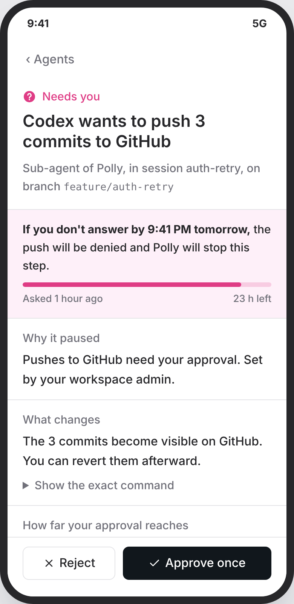

# Agent session patterns: a design study

**Interaction and content patterns for supervising coding agents asynchronously.**

This is an independent design study of [Omnigent](https://github.com/omnigent-ai/omnigent), the open-source meta-harness from Databricks. Databricks has not reviewed or endorsed it.

A person running several coding agents spends most of their attention on the handoffs: human-in-the-loop approvals, policy blocks, errors, and lost connections. Each handoff is a message the person has to understand quickly, often on a phone. This study audits how Omnigent handles those messages today and proposes a harness-neutral interaction model and message architecture for them.

<table>
<tr><th>Omnigent today</th><th>Proposed</th></tr>
<tr>
<td width="55%" valign="top">  The header shows the policy's internal ID and enforcement phase. The message refers to "the agent," and the timeout isn't shown.</td>
<td width="45%"></td>
</tr>
</table>

## Findings at a glance

The [audit](docs/audit.md) covers five areas of Omnigent's interface (commit `ce5f47b`), using its source code and its own visual-test screenshots.

| Area audited | What I found | Proposed fix | How to implement it | Why it matters |
|---|---|---|---|---|
| **Harness voice** in approval and question cards | The same event gets a different title and wording per harness: "Command approval," "Approval required," "Codex needs input," "Claude has questions." Some cards say only "the agent." | One title per event across harnesses: "[Agent name] needs your answer." The harness name moves to the metadata line. | Map each harness's event to one shared string in `ApprovalCard.tsx`. Always pass the agent's display name, and its parent for sub-agents. | Omnigent's value is one layer over many harnesses. Inconsistent copy exposes the harness and slows triage across sessions. |
| **Approval scope** | The "remember" button changes wording per card, and resolved cards show at least 10 different verdict labels. "Remember," "don't ask again," and "always allowed" don't clearly map to a scope. | A three-step [scope ladder](docs/agent-states.md#scope-ladder): Just this once, This session, Always for this agent. Same words on the button and the resolved label. | Collapse the verdict labels into three scope values. Add a "confirming…" suffix while a harness confirms delivery. Disable scopes the reader doesn't own, and name the owner. | Approval scope is a trust decision. People need to know how far a yes reaches before they give it. |
| **Approval timeout** | Unanswered approvals resolve as a deny after 24 hours (default `ask_timeout` of 86,400 seconds). The pending card shows no deadline. The expired card gives a next step but not the outcome. | Show the deadline and default on every pending request. Expired cards lead with the outcome, then the state of the work, then one way back. | Read the effective `ask_timeout` when the elicitation is created and render it on the card. Add an "expired" resolution template. | In async supervision, no answer is the most common answer. The person needs to know what it does before it happens. |
| **Policy messages** | Cards show the internal policy ID and phase (`approve_shell_commands (tool_call)`). Reasons like "Blocked by policy" name no owner. One tells the reader to set `deny_force_push=False`, which most readers can't change. | A [three-layer policy message](docs/agent-states.md#policy-messages-in-three-layers): a plain-language headline, a next move for this reader, and collapsed details for admins. | Add a user-facing `summary` and an `owner` level (session, agent spec, server) to each policy's reason. Move IDs, phases, and parameters into a details section. | Omnigent's own trust model has three policy owners. The reader can only act if they know which one set the rule. |
| **Session status** | Status labels describe the transcript ("Latest message is an error"). Running and Starting share a spinner. The client can stay on "working" when a runner is offline. | Eight harness-neutral [session states](docs/agent-states.md#states), each with a distinct icon. "Working" carries a last-heard time and changes to *Lost contact* past a threshold. | Derive state from runner heartbeats, and compute one badge per session by severity order. Ship the icon set in `docs/images/icons/`. | A spinner that runs while nothing happens makes every other status label harder to trust. |

The audit also lists what Omnigent already does well, such as hedging inferred states ("May need input") and putting the next move into its offline messages.

## Measuring message quality

Agent interface copy is templated and repeated across many harnesses, so manual review doesn't scale. The [evals](evals/) score each message on five checks (Actor, Action, Cause, Consequence, Next move), counting only the checks that apply on its surface.

| Set | Keyword checker (v2) | Passing |
|---|---|---|
| Omnigent's current messages | 2.0 / 10 | 0 of 11 |
| Proposed rewrites | 8.6 / 10 | 10 of 11 |

The keyword checker is a reproducible baseline. An LLM judge calibrated against human scores makes the final call. [SCORING.md](evals/SCORING.md) explains the scores, and [KEYWORD-CHECKER.md](evals/KEYWORD-CHECKER.md) covers the checker's gaps, the fixes, and the scoring workflow.

## Contents

| | |
|---|---|
| **[Audit](docs/audit.md)** | The five findings in full, with screenshots, source references, and today-versus-proposed comparisons |
| **[Pattern spec](docs/agent-states.md)** | Session states, icons, a state diagram, the seven-part approval anatomy, the scope ladder, and policy message layers |
| **[Prototype](prototype/)** | A mobile prototype for cross-session triage, approvals, policy blocks, lost contact, and expired requests. [View it live](https://jkelleman.github.io/omnigent-agent-session-patterns/design-study/prototype/). |
| **[Evals](evals/)** | The rubric, 11 real Omnigent strings with 11 rewrites, the keyword checker, and the LLM judge |

## How this was made

I built this with coding agents. Claude Code handled the source reading, scaffolding, and prototype build under my direction, and the commit history shows the work.

---

*Jen Kelleman, content and product designer for AI agents. [jkelleman.com](https://jkelleman.com)*
