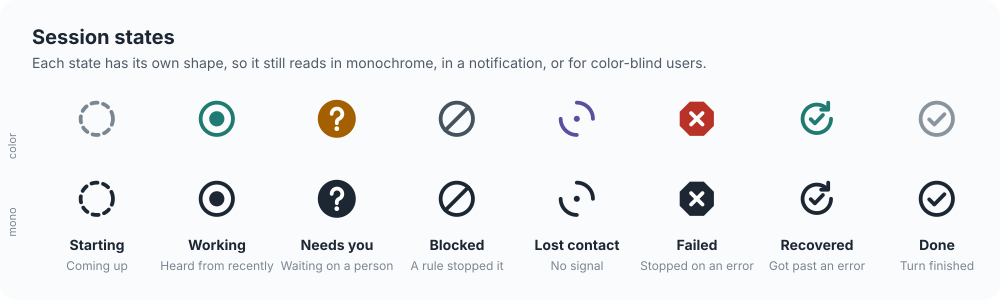
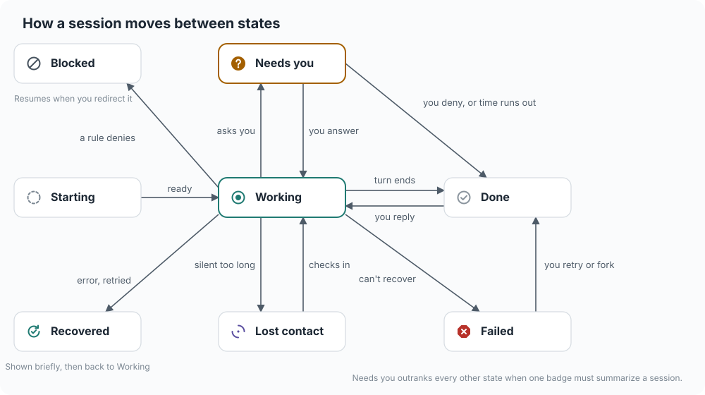
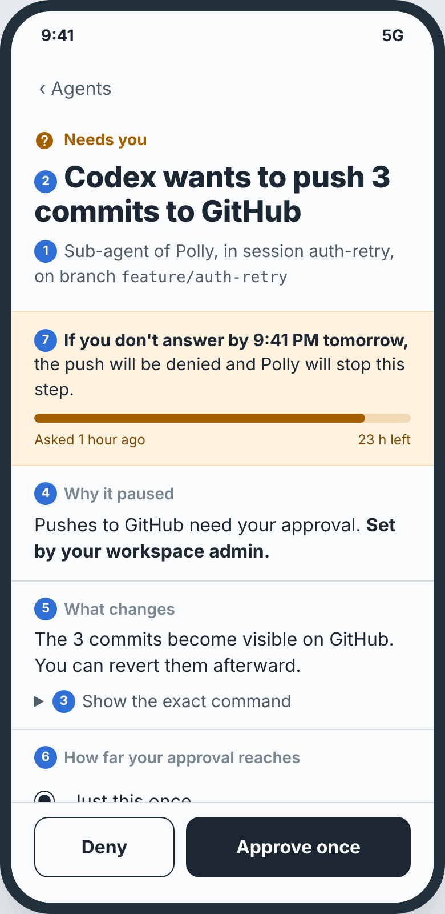

# Agent session states: a pattern spec

This spec defines a shared vocabulary for agent session state: what the agent is doing, what the person can do about it, and what the interface says in each case. It's harness-neutral, so a state looks and reads the same whether Claude Code, Codex, or a custom YAML agent is running.

Each state is mapped to Omnigent's current implementation (`SessionStateBadge.tsx`, `ApprovalCard.tsx`, and `docs/POLICIES.md` at commit `ce5f47b`) to show where the gaps are.

## Principles

1. **Name the actor and the rule owner.** Every pause names the agent, its parent if it's a sub-agent, and the owner of the policy that caused it: the user, the agent's author, or the workspace admin.
2. **Show the scope of an approval before the tap.** The button and the resolved label use the same scope words.
3. **State the timeout and its default.** Every pending request shows its deadline and what happens when the deadline passes.
4. **Only report activity the system can confirm.** "Working" always carries a last-heard time. Past a threshold, the state changes to *Lost contact*.
5. **Give every problem a next move for this reader.** When the fix belongs to someone else, name that person or role.
6. **Hedge inferred states.** When the system infers a state, the copy says "may." Omnigent already does this with "May need input."
7. **Keep the voice consistent across harnesses.** Harness names go in metadata. Headlines describe the event.

## States

Each state has a distinct shape, so it reads in monochrome, in a notification, and for color-blind users. The SVGs are in [`images/icons/`](images/icons/).

| State | Meaning | What the person can do | Omnigent today | Gap |
|---|---|---|---|---|
|  **Starting** | The runner, sandbox, or harness is booting | Wait or cancel | `starting` ("Session starting up") | Uses the same spinner as running; no progress or ETA for slow sandbox boots |
|  **Working** | The agent is acting, and the runner checked in recently | Watch, steer, stop | `running` ("Session running" / "Working in the background") | No last-heard time; can stay on "working" when the runner is offline |
|  **Needs you** | The agent is paused on a person: an approval, a question, or a plan review | Answer, or open details | `awaiting` ("Needs response" / "May need input") | The deadline and default aren't shown while the request is pending |
|  **Blocked** | A policy denied an action, and the agent can't continue that path | Redirect the task, or ask the rule's owner | Shown as an agent error in the transcript | No distinct state; the reason doesn't name the rule's owner |
|  **Lost contact** | No signal from the runner or host past a threshold | Reconnect, move to the cloud, or wait | `disconnected` ("Host disconnected") | Covers the host only; a silent runner isn't shown |
|  **Failed** | The agent stopped on an error it couldn't recover from | Retry, fork from before the error, or read the log | `error` ("Latest message is an error") | The label describes the last message and doesn't say whether the agent stopped |
|  **Recovered** | The agent hit an error and recovered on its own | Nothing required; can review | None | Recovery isn't shown, so the error badge can outlast the problem |
|  **Done** | The turn finished | Review the changes, reply | `idle` / `unseen` ("New messages") | None |

### State transitions

### Severity order

When one badge has to summarize a session, the highest-severity state wins:

Needs you › Lost contact › Failed › Blocked › Working › Starting › Recovered › Done

A request waiting on a person ranks first, because in a multi-agent fleet the person's attention is the bottleneck.

## Anatomy of a "Needs you" request

Every approval request carries seven parts, on every surface:

| # | Part | Example |
|---|---|---|
| 1 | **Who** | "Codex, sub-agent of *Polly*, on `feature/auth-retry`" |
| 2 | **Wants to** (plain words) | "Push 3 commits to GitHub" |
| 3 | **Exact action** (collapsed on mobile) | `git push origin feature/auth-retry` |
| 4 | **Why it paused** | "Pushes need approval. *Set by your workspace admin.*" |
| 5 | **What changes** | "3 commits become visible on origin. Can be reverted." |
| 6 | **Scope of your answer** | Just this once, This session, Always for this agent |
| 7 | **If you don't answer** | "Denied automatically at 9:41 PM tomorrow. The agent will stop this step." |

On a phone, parts 1, 2, 4, and 7 are always visible, and the rest are one tap away. Approve and Deny sit within thumb reach, and Deny is never the visually dominant button.

## Scope ladder

The same scope words appear on the button and on the resolved label:

| Scope | Button | Resolved label | Omnigent verdicts it replaces |
|---|---|---|---|
| Once | **Approve** | "Approved once" | "Approved" |
| Session | **Approve for this session** | "Approved for this session" | "Approved for this session", "Session allow requested", "Approved · directory access for this session", "Approved · auto mode" |
| Always | **Always allow for this agent** | "Always allowed for *[agent]*" | "Always allowed", "Approved · won't ask again", "Approved and remembered", "Always allow requested" |

- **Pending confirmation:** while the harness hasn't confirmed delivery, keep the verb and add a suffix: "Approved for this session, confirming…"
- **Rules the reader doesn't own:** when a server policy makes a scope unavailable, show the option as disabled and name the owner: "Only your admin can change this rule."

## Policy messages in three layers

| Layer | Audience | Example |
|---|---|---|
| **Headline** | The person deciding | "Force pushes aren't allowed in this workspace." |
| **Next move** | The person deciding | "Ask the agent to push without force, or ask your admin." |
| **Details** (collapsed) | Policy author or admin | "Policy `github_access`, `deny_force_push=True`, server-wide" |

## Session relationships

Omnigent sessions can be watched, co-driven, and forked. Each relationship gets one persistent cue:

| Relationship | Cue |
|---|---|
| **Watching** | "View only: *[owner]*'s session." A view-only banner takes the composer's place. |
| **Co-driving** | Avatars of everyone who can send input. Each message is attributed to its sender. |
| **Forked** | "Forked from *[session]* at *[step]*," with a link back. Approvals from the original session don't carry over, and the fork says so. |

## Open questions for the team

- Should **Recovered** appear on mobile, or only in the session log?
- Who can lift a **Blocked** state in a co-driven session: the owner only, or any participant?
- Is 24 hours the right default timeout for approvals answered on a phone? Should the timeout scale with the action's blast radius?
