# Audit: approvals, status, and errors in Omnigent

**Scope:** the handoffs where a person has to understand or act on an agent running unattended: approval prompts, session status, policy blocks, timeouts, and errors.

**Method:** Part 1 is a source read of [omnigent-ai/omnigent](https://github.com/omnigent-ai/omnigent) at commit `ce5f47b` (Nov 15, 2026). The screenshots of Omnigent today are its own visual-test reference images and docs images (see [the notice](images/omnigent/NOTICE.md)). Part 2 is hands-on use on desktop and phone.

**Note:** Omnigent is in alpha, and much of it already works well. The audit also lists the patterns worth keeping, so they survive as the product changes.

---

## The surfaces today

<table>
<tr>
<td width="68%">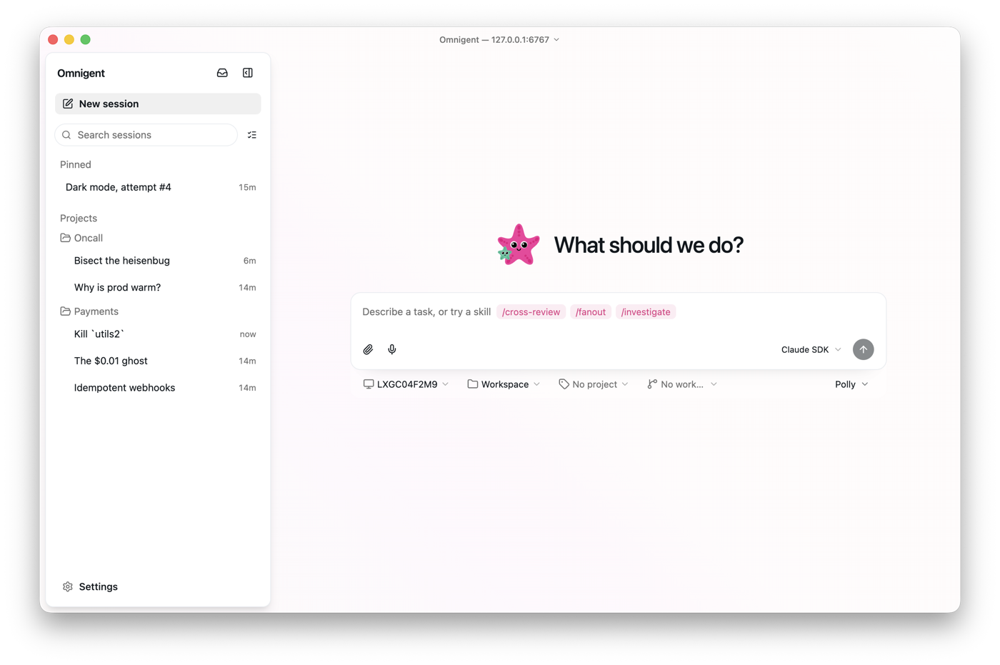</td>
<td width="32%">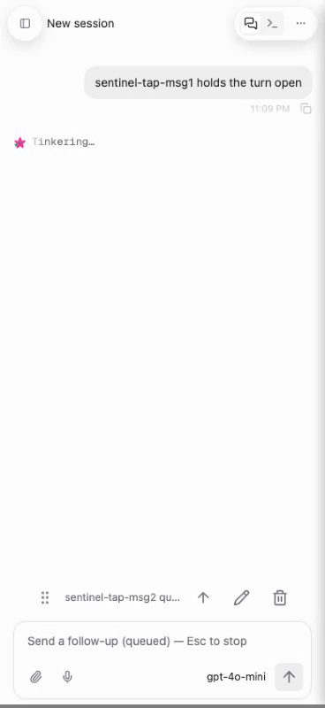</td>
</tr>
<tr>
<td><b>Desktop.</b> Sessions are listed by project and recency. Each session's state is a small badge at the right edge of the sidebar.</td>
<td><b>Phone.</b> Today the phone shows one session at a time, as a chat. There's no cross-session view of what needs you.</td>
</tr>
</table>

---

## Part 1: What the source shows

### 1. The same event reads differently in each harness

When an agent stops to ask the person something, both the card's header and its wording depend on which harness is underneath:

<table>
<tr>
<td>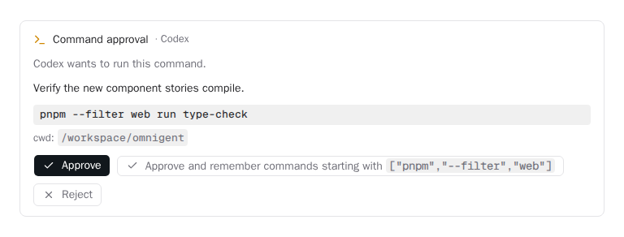</td>
<td>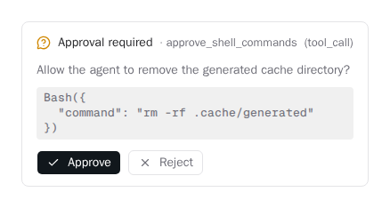</td>
<td>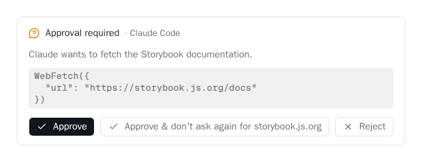</td>
</tr>
<tr>
<td>Title: "Command approval" Body: "Codex wants to run this command."</td>
<td>Title: "Approval required" Body: "Allow <b>the agent</b> to remove…"</td>
<td>Title: "Approval required" Body: "Claude wants to fetch…"</td>
</tr>
</table>

Question cards vary the same way:

| Harness | Card title |
|---|---|
| Claude | "Claude has questions" |
| Codex | "Codex needs input" |
| Cursor | "Cursor has questions" |
| Pi, Devin, Antigravity | "… needs your input" |

`web/src/components/blocks/ApprovalCard.tsx`

**Why it matters:** Omnigent's value is a single layer over many harnesses, and inconsistent wording exposes the harness underneath. A person scanning five sessions on a phone has to read each card closely to see that they describe the same event. When a card says only "the agent," a person running several agents can't tell which one is asking.

**Pattern:** use one title per event across all harnesses: **"[Agent name] needs your answer."** The harness name moves to the metadata line.

### 2. Approval scope uses different words before and after the tap

Before the tap, the "remember" button changes from card to card:

<table>
<tr>
<td></td>
<td></td>
</tr>
<tr>
<td>"Approve and remember"</td>
<td>"Approve & don't ask again for storybook.js.org"</td>
</tr>
</table>

After the tap, the resolved card can show at least 10 different labels (`ApprovalCard.tsx`, around lines 793–855):

| Labels that mean "this session" | Labels that mean "from now on" | Others |
|---|---|---|
| "Approved for this session" | "Approved · won't ask again" | "Approved" |
| "Session allow requested" | "Approved and remembered" | "Approved · auto mode" |
| "Approved · directory access for this session" | "Always allowed" | "Approved · auto-accepting edits" |
| | "Always allow requested" | |

Each label is accurate on its own. Together, they leave the person unsure **how far an approval reaches.** "Remember," "don't ask again," and "always allowed" may or may not grant the same scope, and the wording doesn't say.

**Pattern:** a three-step scope ladder (**Just this once**, **This session**, **Always for this agent**), worded the same on the button and on the resolved label.

<table>
<tr><th>Proposed: choose the scope before you tap</th><th>Proposed: the same words afterward</th></tr>
<tr>
<td width="50%">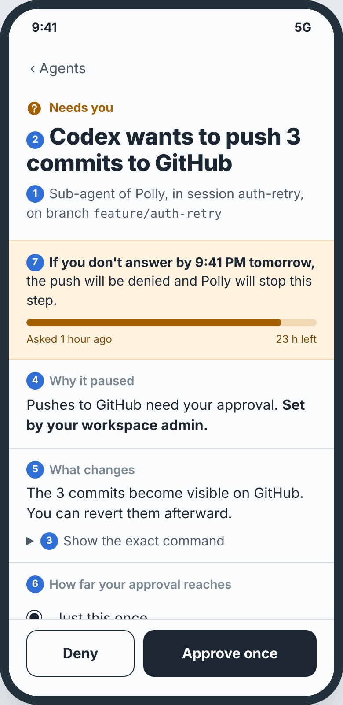</td>
<td width="50%">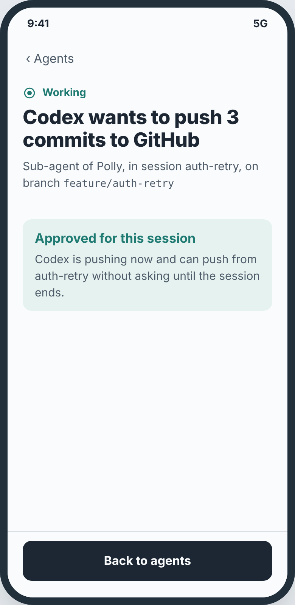</td>
</tr>
</table>

The numbers mark the seven parts of a request. See [agent-states.md › Anatomy](agent-states.md#anatomy-of-a-needs-you-request).

### 3. The approval timeout is hidden until it expires

- **The timeout:** the default `ask_timeout` is **86,400 seconds (24 hours)** (`omnigent/spec/types.py`). On timeout, the request resolves as a deny, and any state the policy would have written is dropped: "a denied ASK must leave no trace" (`omnigent/runtime/policies/approval.py`).
- **While the request is pending,** the card shows Approve and Reject, but no deadline and no default.
- **After the deadline,** the card is clear about the next step:

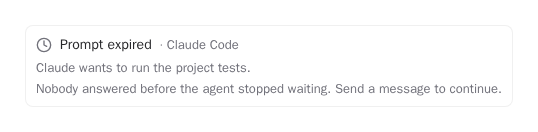

"Send a message to continue" gives a clear next move. The card leaves out the **outcome**: "the agent stopped waiting" describes the agent's state, and doesn't say that the action was denied or what state the work is in. The person also learns about the deadline only after it passes.

**Pattern:**

- While pending, every approval states its deadline and default.
- An expired card leads with the outcome ("Nobody answered, so the push was denied"), then the state of the work, then one way back.

<table>
<tr><th>Proposed: the deadline while it's pending</th><th>Proposed: the outcome after it passes</th></tr>
<tr>
<td width="50%">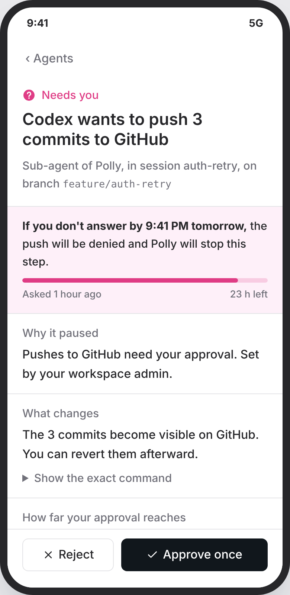</td>
<td width="50%">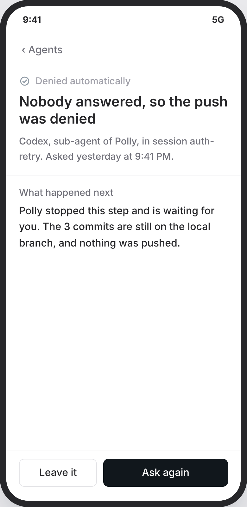</td>
</tr>
</table>

### 4. Policy messages are written for policy authors

Omnigent's own docs describe three policy owners:

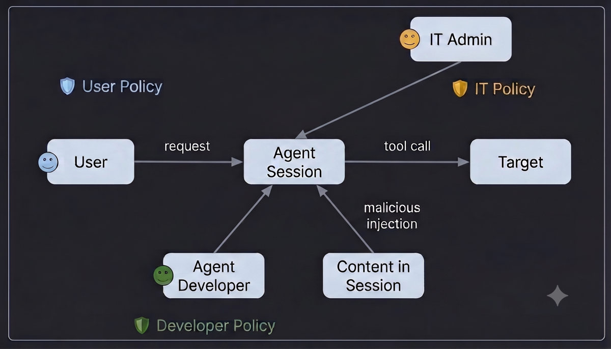

The interface doesn't say which owner set a rule. It shows the policy's internal name and enforcement phase:

<table>
<tr>
<td></td>
<td>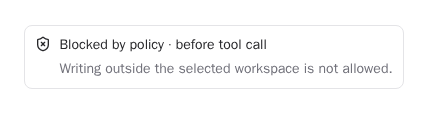</td>
</tr>
<tr>
<td>Header: <code>approve_shell_commands (tool_call)</code></td>
<td>"Blocked by policy · before tool call." The reason is clear, but the message names no owner and no next move.</td>
</tr>
</table>

The built-in policy reasons follow the same pattern. Each reason becomes the `message` on the elicitation request that reaches the approval surface (`approval.py`: `ElicitationRequest(message=result.reason …)`):

- "Elevated session risk."
- "Blocked by the blast-radius policy."
- "GitHub operation blocked by policy."
- "Force push is blocked by policy. Remove the force flag (--force / -f / --force-with-lease / --force-if-includes / +refspec) or set deny_force_push=False."

The last reason tells the reader to change a setting. Rules set in an agent's spec can't be changed from a session (`designs/CUJ-ANALYSIS.md` §2.D), and server rules belong to the admin, so the person reading the message often has no way to act on it.

**Pattern:** every policy message states the rule in plain words, **who owns it**, and the move available to this reader. Configuration details go in a collapsed "Details for admins" section.

<table>
<tr><th>Proposed: a policy block in three layers</th></tr>
<tr><td width="50%">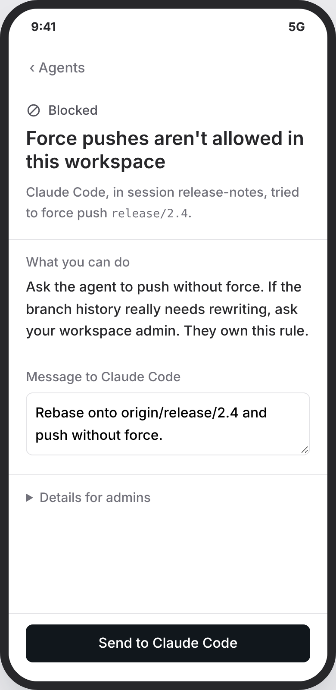</td></tr>
</table>

### 5. Status labels describe the transcript

<table>
<tr>
<td width="62%">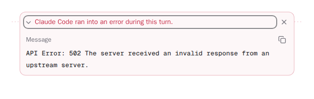</td>
<td width="38%">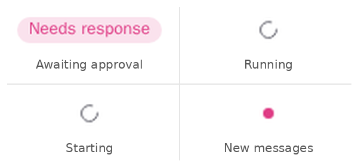</td>
</tr>
<tr>
<td>The card reports a failure and shows the raw API error. It doesn't say whether the agent stopped, will retry, or needs the person.</td>
<td>Running and Starting render the same spinner. The error badge's tooltip reads "Latest message is an error."</td>
</tr>
</table>

The team's own reliability analysis notes that when a runner goes offline, the client can stay **stuck on "working" until timeout** (`CUJ-ANALYSIS.md` §2.A). A spinner that runs while nothing is happening makes every other status label harder to trust.

**Pattern:** status answers two questions: what the agent is doing, and whether it can continue. "Working" always carries a last-heard time and changes to **Lost contact** past a threshold. Each state also has a distinct shape, so color isn't the only signal:

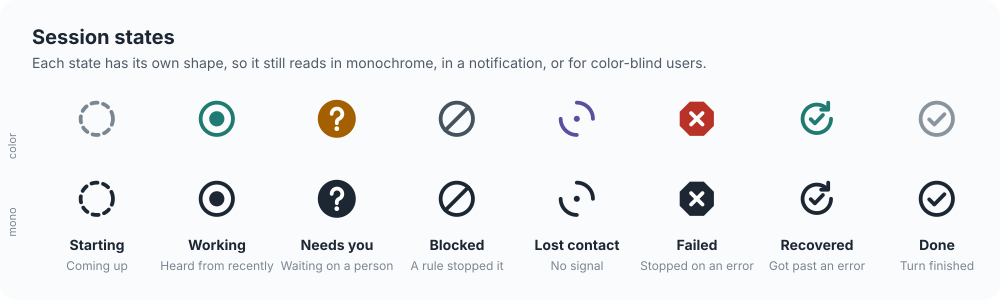

<table>
<tr><th>Proposed: triage across sessions</th><th>Proposed: honest about lost contact</th></tr>
<tr>
<td width="50%">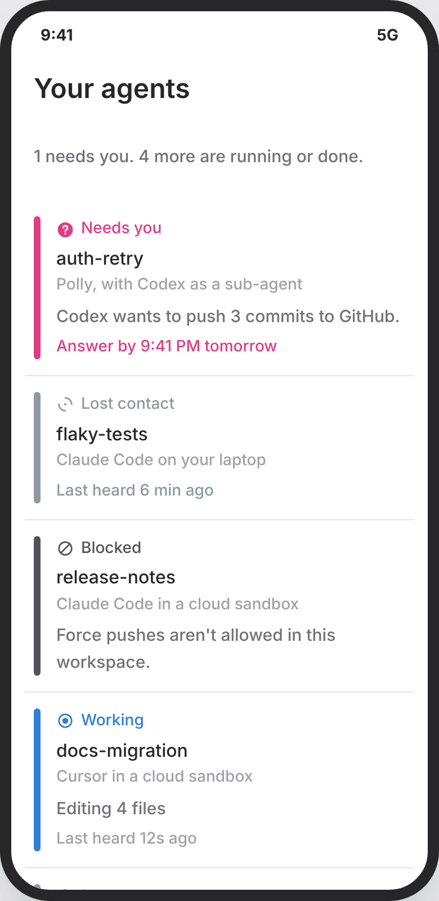</td>
<td width="50%">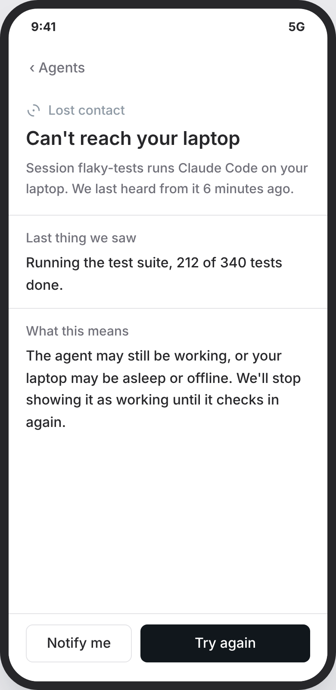</td>
</tr>
</table>

### Already done well (keep these)

<table>
<tr>
<td>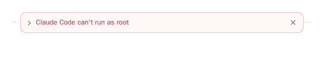</td>
<td>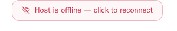</td>
<td>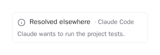</td>
</tr>
<tr>
<td>Names the agent and states a known error in plain words.</td>
<td>States the problem and the next move in one line.</td>
<td>Explains why a card closed without the person's input.</td>
</tr>
</table>

- **Inferred states are hedged.** When the runner infers from the terminal screen that it's waiting for input, the badge reads **"May need input."** A code comment explains the choice: "The runner infers this reason from the terminal's screen, so stay tentative." This belongs in the written content guidelines.
- **Requests from sub-agents are attributed** ("Requested by sub-agent …").
- **The expired card gives a next step** ("Send a message to continue").
- **Policy composition is well defined:** session, then spec, then admin; the first DENY wins, and multiple ASK verdicts merge into one approval. The interface can explain this model directly.

---

## Part 2: Hands-on

*In progress: I'm running real sessions with Claude Code and Codex on the desktop app and the phone, focused on approvals made from the phone and on reconnecting after a host drops.*
