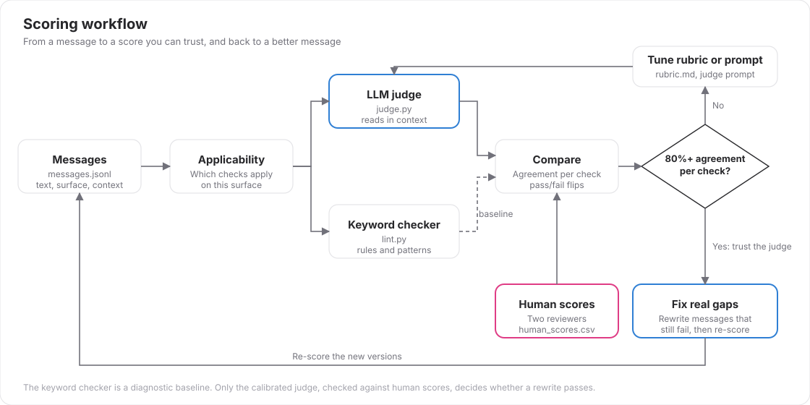

# Keyword checker: gaps, fixes, and workflow

The keyword checker (`lint.py`) is a rule-based baseline for the [rubric](rubric.md). It runs without an API key, so anyone can reproduce it. This note covers the gaps found in version 1, what version 2 changes, the results before and after, and what rules still can't do.

## Where the checker fits

1. **Messages** carry their text, the surface they appear on, and what else is visible there.
2. **Applicability** decides which of the five checks apply on that surface.
3. **The LLM judge** scores each message in context. **The keyword checker** scores it with rules, as a baseline.
4. **Compare** both against **human scores** from two independent reviewers.
5. **Below 80% agreement** on any check, tune the rubric or judge prompt and run the judge again.
6. **At 80% or above,** trust the judge. Rewrite any message that still fails, and re-score it.

## Gaps in version 1

### 1. No surface context

v1 read only the message text. It ignored the `context` field, which records what else is on screen.

- **Example:** `r-push-ask` scored 0 on Next move, though the Approve and Reject buttons sit on the same card.
- **Effect:** every approval message lost 2 points, including messages that were complete.

### 2. Every surface scored on all five checks

v1 expected a card title, a tooltip, and a resolved label to carry a full message.

- **Example:** the title `r-codex-title` ("Codex needs your answer to continue auth-retry") scored 3 out of 10. The question and answer options appear in the card body below it.
- **Example:** the resolved label `r-remember` scored 0 on Cause. The cause was stated on the original request, so the label has none to repeat.
- **Effect:** short, correct messages failed for missing parts that live elsewhere on the surface.

### 3. Narrow phrase lists

v1 matched a short list of exact phrases, so common wording slipped past it.

| Missed phrase | Check | Message |
|---|---|---|
| "If you deny it, Polly will skip this step" | Consequence | `r-blast-ask` |
| "Claude Code may still be working" | Action | `r-host` |
| "To clean that folder, run the command yourself" | Next move | `r-blast-deny` |

v1 only found an imperative at the start of a sentence, and only counted a fixed set of consequence phrases.

### 4. A hard-coded actor pattern

v1 recognized agent context partly through literal names from the test set, such as `auth-retry`. That pattern wouldn't generalize to new messages.

### 5. No model of the reader

Rules can't tell whether a suggested move is available to this reader. "Ask your admin" is a real option for most people, and "set `deny_force_push=False`" is only an option for an admin. v1 handles the narrow case (configuration syntax scores 0 on Next move) and can't handle the general one.

## Fixes in version 2

| Gap | Fix in `lint.py` |
|---|---|
| 1. No surface context | Reads `context`. For approval messages, visible Approve and Reject (or Deny) controls count as a Next move. A visible session title gives partial Actor credit for tooltips. |
| 2. All five checks on every surface | An `APPLIES` table lists the checks for each surface. Checks that don't apply are scored `n/a`, and the total is scaled to 10 over the applicable checks. |
| 3. Narrow phrase lists | Broader patterns: conditional consequences ("if you deny…", "will skip / stop / continue / tell"), hedged activity ("may still"), and imperatives after a comma, colon, or "or". |
| 4. Hard-coded actor | Actor context comes from general patterns: a parent agent ("sub-agent"), kebab-case session names, repo or branch paths, and where the agent runs ("on your laptop", "in a cloud sandbox"). |
| 5. No reader model | Unchanged by design. This is the judge's job. The configuration-syntax rule stays. |

The rubric and the judge use the same applicability table. `judge.py` tells the model which checks apply and stores `null` for the rest, and the human score template accepts `n/a`.

## Results

| Set | v1 mean | v1 passing | v2 mean | v2 passing |
|---|---|---|---|---|
| Omnigent's current messages | 1.2 | 0 of 11 | 2.0 | 0 of 11 |
| Proposed rewrites | 6.6 | 3 of 11 | 8.6 | 10 of 11 |

| Rewrite | v1 | v2 | What changed |
|---|---|---|---|
| `r-codex-title` | 3, fail | 10, pass | Scored as a title (Actor and Action only) |
| `r-blast-ask` | 5, fail | 9, pass | Conditional consequence found; buttons counted |
| `r-host` | 5, fail | 7.5, pass | "May still be working" counted as Action; Cause n/a for a tooltip |
| `r-blast-deny` | 6, fail | 8, pass | Mid-sentence imperative found |
| `r-remember` | 6, fail | 7.5, pass | Cause n/a for a resolved label |
| `r-risk` | 8, fail | 9, pass | Buttons counted |
| `r-push-ask` | 8, fail | 10, pass | Buttons counted |
| `r-gh-deny` | 7, fail | 8, **fail** | Still 0 on Consequence |
| `r-force` | 9, pass | 9, pass | No change |
| `r-expired` | 8, pass | 8.8, pass | Cause n/a for a resolved label |
| `r-error-badge` | 8, pass | 7.5, pass | Scaled over four checks |

Omnigent's messages rose slightly: their approval cards also have buttons, and their sidebar tooltips sit next to a visible session title. They still fail every check that depends on the words: actor, cause, and consequence.

## Real gaps v2 surfaces

With the scorer noise removed, the remaining low scores point at the messages themselves:

- **`r-gh-deny` fails on Consequence.** It explains the block and offers next moves, but doesn't say what Codex does after the block. Fix: add "Codex will continue without opening the PR."
- **Actor scores 1 on several rewrites.** `r-risk`, `r-blast-ask`, `r-blast-deny`, `r-error-badge`, `r-host`, `r-expired`, and `r-remember` name the agent but not the session. Fix: add the session name, for example "in session release-notes."
- **`r-error-badge` and `r-host` score 1 on Consequence.** Neither says plainly whether the work is safe. Fix: add one clause on the state of the work.

These are content fixes. They don't change the checker.

## Limits that remain

- **It still can't judge meaning.** A message can match every pattern and still mislead. The judge and human reviewers remain the reference.
- **It was tuned on these 22 messages.** The new patterns are general, but improvements measured on the same messages they were built from overstate accuracy. Score a held-out set before relying on v2: the messages collected in the [validation sessions](../docs/validation-plan.md).
- **It can't model the reader.** Whether a move is available depends on the reader's role, which the judge has to infer from context.

## What to do next

1. Fix the real gaps listed above in `messages.jsonl`, and re-run `python evals/lint.py --out evals/results/lint-baseline.md`.
2. Score all 22 messages in `human_scores.csv`, using `n/a` for checks that don't apply.
3. Compare your scores with v2's per check. Where they disagree often, a pattern is wrong or missing.
4. Run the LLM judge with `--human`, and follow the workflow above until agreement reaches 80% per check.
5. Write the held-out set, and score it with all three: human reviewers, the judge, and v2.

Version 1's full results are kept in [`results/lint-v1.md`](results/lint-v1.md) for comparison.
